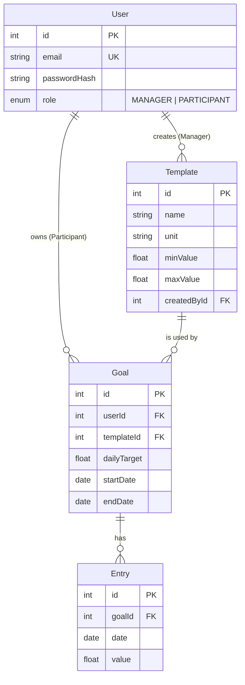

# System-Level Software Design Specification — Habit & Activity Tracking

Version 1.0 (Sprint 1 baseline). Requirement IDs refer to `docs/srs.md`.

## 1. Architecture overview

Three tiers, one repository:

| Tier | Technology | Folder | Responsibility |
| --- | --- | --- | --- |
| Web UI | React + TypeScript (Vite) | `frontend/` | Screens for login, templates, goals, entries, progress. Calls the API only. |
| Application / API | Express + TypeScript | `backend/` | Authentication, authorization, business rules, validation. The single place rules are enforced. |
| Data | PostgreSQL via Prisma | `backend/prisma/` | Persistence, uniqueness constraints, migrations. |

Design principle: **every rule is enforced in the API**. The UI may hide or disable controls for
convenience, but a direct API call must be rejected exactly as a UI call would be (NFR-02).

Requests flow: UI → HTTP/JSON → route handler → middleware (`requireAuth`, `requireRole`) →
service logic (validation + rules) → Prisma → PostgreSQL.

## 2. Technology and tooling

| Concern | Choice |
| --- | --- |
| Language | TypeScript (backend and frontend) |
| Backend framework | Express |
| ORM / migrations | Prisma (`backend/prisma/schema.prisma`, migrations committed) |
| Database | PostgreSQL |
| Password hashing | bcrypt (salted hash, NFR-01) |
| Sessions | `express-session` with an HTTP-only cookie; session data held server-side |
| Backend tests | Vitest + Supertest against the app object (no network port) |
| Package manager | npm |
| Local database | `docker-compose.yml` starts PostgreSQL only; the app itself is not containerised until Lab 5 |

## 3. Data model



Constraints:

- `User.email` is unique.
- `Entry` has a unique constraint on (`goalId`, `date`). This is the database backstop for BR-01;
  the API checks first and returns 409.
- Dates (`startDate`, `endDate`, `Entry.date`) are calendar dates without time of day (SRS A-02). "Today"
  for BR-03, BR-04 and BR-09 is the current date in the **Asia/Bangkok** time zone, computed by the server.
- Numbers: `value`, `dailyTarget`, `minValue`, `maxValue` are floats limited to two decimal places
  (input with more is rejected with 400) and are compared after rounding to two decimals (SRS D-07).
- BR-04 (no overlapping goals for the same template) cannot be a plain unique constraint because it
  depends on date ranges. It is enforced inside a database transaction that first takes a per-(user, template)
  advisory lock (`pg_advisory_xact_lock`), then checks for an existing goal of the same user and template whose range overlaps
  (existing.start ≤ new.end and new.start ≤ existing.end) and inserts. Two concurrent
  requests are therefore serialised and the second receives 409.
- Changing a template's min/max affects only new input (SRS D-06); existing goals and entries are not
  revalidated.
- Overlap (BR-04) is computed from stored start and end dates; nothing extra is stored.
- Deleting is not part of Sprint 1, so no cascade behaviour is relied on.

## 4. Roles and permissions

| Action | Anonymous | Participant | Manager |
| --- | --- | --- | --- |
| Log in | yes | yes | yes |
| Log out, read current user | — | yes | yes |
| List templates | no (401) | yes | yes |
| Create / update template | no (401) | no (403) | yes |
| Create goal | no (401) | yes | no (403) |
| Read own goals, entries, progress | no (401) | yes | no (403) |
| Read another user's goal, entries, progress | no (401) | no (404) | no (403) |
| Create entry on own goal | no (401) | yes | no (403) |

Status-code policy (SRS D-05): 401 = no valid session; 403 = signed in but role not allowed (this
includes a Manager calling Participant-only endpoints, so the role gate answers before any lookup);
404 = a Participant asks for a record that belongs to someone else or does not exist (so existence is
not revealed). Check order on every endpoint: 401, 403, 400 for body-shape validation only, 404 for
ownership or existence, then validation that depends on the goal's or template's data (BR-01, BR-02,
BR-03).

## 5. Authentication and session design

- The session cookie is `HttpOnly` and `SameSite=Lax`, plus `Secure` when deployed over HTTPS. `SameSite=Lax`
  is the CSRF protection for the cookie-authenticated POST/PUT endpoints; the API accepts JSON only and
  CORS allows only the configured frontend origin (no wildcard).
- Login rate limiting and account lockout are out of scope for Sprint 1 and recorded as a known limitation.
- `POST /auth/login` checks email and password with bcrypt. On success it stores the user id and
  role in the server-side session and sets an HTTP-only cookie. On any failure it returns 401 with
  one generic message (does not say whether the email or the password was wrong).
- `POST /auth/logout` destroys the server-side session; the cookie is cleared. A request that
  still presents the old cookie gets 401.
- `GET /auth/me` returns `{ id, email, role }` for the current session or 401.
- Middleware `requireAuth` rejects requests without a valid session (401). `requireRole(role)`
  rejects a wrong role (403). Ownership checks (BR-08) happen in the service layer and return 404.
- Sprint 1 uses the in-memory session store. This is acceptable for a single process and is
  recorded as a known limitation; a PostgreSQL-backed store replaces it before deployment (Lab 5).
- A session lasts **8 hours**: both the cookie's `maxAge` and the store's TTL are set to 8 hours.
  It does not auto-renew on activity.
- Accounts are seeded (one Manager, two Participants). Passwords come from environment variables
  at seed time, never from source code.

## 6. API conventions

- JSON request and response bodies; paths are lower-case and plural for collections.
- Success: `200` (read/update), `201` (create).
- Error body: `{ "error": { "code": "<MACHINE_CODE>", "message": "<human readable>" } }`.
- Validation happens before any database write. Unknown or malformed fields are rejected with 400.
- Dates are exchanged as `YYYY-MM-DD` strings.

| Status | Meaning | Examples |
| --- | --- | --- |
| 400 | Input violates a rule | value outside range, future date, min ≥ max |
| 401 | No valid session | not logged in, after logout, wrong credentials |
| 403 | Role not allowed | Participant creates a template |
| 404 | Not found or not yours | another participant's goal |
| 409 | Conflicts with existing data | second entry on same date, goal overlapping an existing goal on the same template |

### 6.1 Endpoint inventory (Sprint 1)

| Endpoint | Role | Feature | Requirements |
| --- | --- | --- | --- |
| `POST /auth/login` | any | F-01 | FR-01 |
| `POST /auth/logout` | logged in | F-01 | FR-02 |
| `GET /auth/me` | logged in | F-01 | FR-02 |
| `GET /templates` | logged in | F-02 | FR-05 |
| `POST /templates` | Manager | F-02 | FR-03, BR-06, BR-07 |
| `PUT /templates/:id` | Manager | F-02 | FR-04, BR-06, BR-07 |
| `POST /goals` | Participant | F-03 | FR-06, BR-04, BR-05 |
| `GET /goals` | Participant | F-03 | FR-06, BR-08 |
| `GET /goals/:id` | Participant (owner) | F-03 | FR-06, BR-08 |
| `POST /goals/:id/entries` | Participant (owner) | F-04 | FR-07, BR-01, BR-02, BR-03 |
| `GET /goals/:id/entries` | Participant (owner) | F-04 | FR-09, BR-08 |
| `GET /goals/:id/progress` | Participant (owner) | F-04 | FR-08, BR-09 |
| `GET /health` | any | — | operations |

Detailed request/response shapes, acceptance criteria and tests are in the feature contracts under
`docs/sprints/sprint-1/`.

## 7. User interface conventions

- Separate screens for login, template list/management (Manager), and goals/entries/progress
  (Participant).
- After login the UI reads `GET /auth/me` and shows only the screens that role may use. This is a
  convenience; the API still enforces permissions.
- Server error messages are shown to the user as returned; the UI does not duplicate business rules
  beyond basic form hints.

## 8. Configuration and secrets

| Variable | Purpose |
| --- | --- |
| `DATABASE_URL` | Development database connection |
| `DATABASE_URL_TEST` | Separate database used only by the automated tests |
| `SESSION_SECRET` | Signs the session cookie |
| `PORT` | Backend port |
| `SEED_*` | Passwords for seeded accounts, read only by the seed script |

Real values live in a local `.env` that is git-ignored. `.env.example` contains placeholders only
(NFR-03). Tests reset only the database named by `DATABASE_URL_TEST`, and the test setup refuses to run
if `DATABASE_URL_TEST` is missing or equal to `DATABASE_URL`, so a test reset can never wipe the dev database.

## 9. Testing strategy

- Domain rules, persistence and access restrictions are tested at the API level with Vitest and
  Supertest, so a rule is verified the same way a UI call would exercise it.
- Each acceptance criterion in a feature contract has at least one test; the test name carries the
  criterion ID.
- Access tests call the API directly with no session, the wrong role, and another user's id.
- A small number of UI end-to-end journeys cover the main flow (add when the UI exists).
- One command runs the whole suite (NFR-04): `npm test` in `backend/`.

## 10. Deployment plan (design for later)

Sprint 1 runs locally. The design keeps later deployment simple:

- Configuration only through environment variables (twelve-factor style).
- Backend exposes `GET /health` for liveness checks.
- Lab 5 adds Dockerfiles for backend and frontend, a CI pipeline running `npm test`, and deployment
  to GCP with a managed PostgreSQL instance and a persistent session store.
- Lab 5 note: once the app sits behind a proxy or load balancer (GCP deployment), Express must be
  configured with `app.set("trust proxy", 1)`, otherwise Express sees the proxy's plain-HTTP
  connection and never sends the session cookie's `Secure` attribute, even over real HTTPS.
- Lab 5 note: `SameSite=Lax` cookies are not sent on cross-site requests, including a frontend and
  API served from different registrable domains (e.g. `app.example.com` and `api.example-two.com`).
  Same-site subdomains of one registrable domain (e.g. `app.example.com` and `api.example.com`) are
  fine under `Lax`. If the deployed frontend and API end up on different registrable domains, either
  serve both from one origin (e.g. the API under `/api` behind the same host) or switch the cookie to
  `SameSite=None; Secure`.

## 11. Repository layout

```
backend/            Express app, Prisma schema and migrations, seed script, tests
frontend/           React app
docs/               srs.md, system-sds.md, features.md, traceability.md,
                    sprints/plan.md, sprints/sprint-1/, labs/
docker-compose.yml  Development PostgreSQL only
```

Branching: Issue → feature branch from `sprint-1-staging` → pull request reviewed by the other
student → merge to `sprint-1-staging` → reviewed release PR to `main` → tag.
